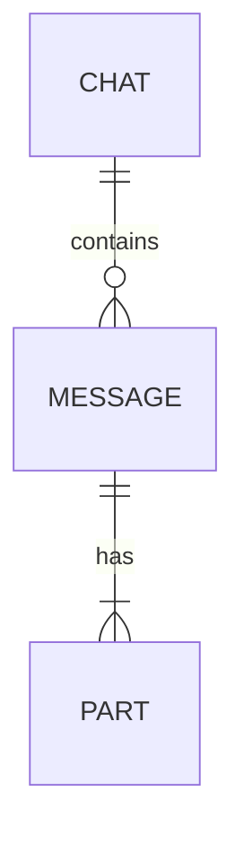
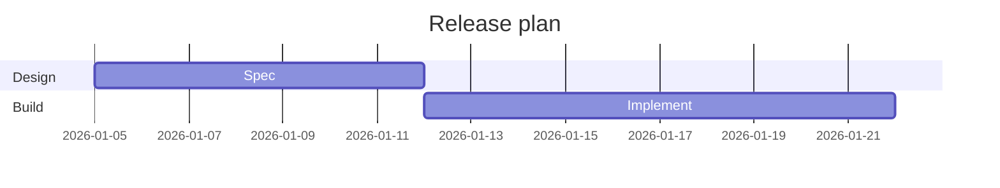
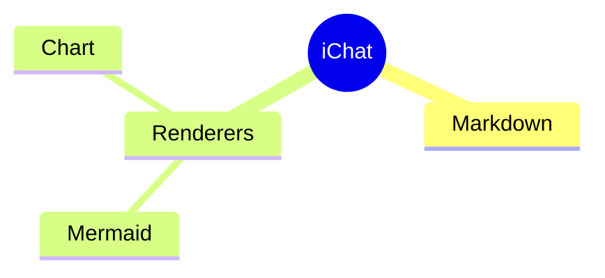
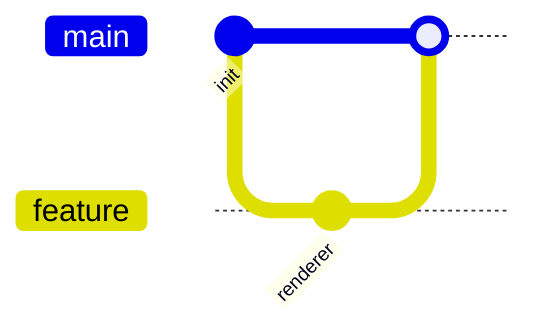
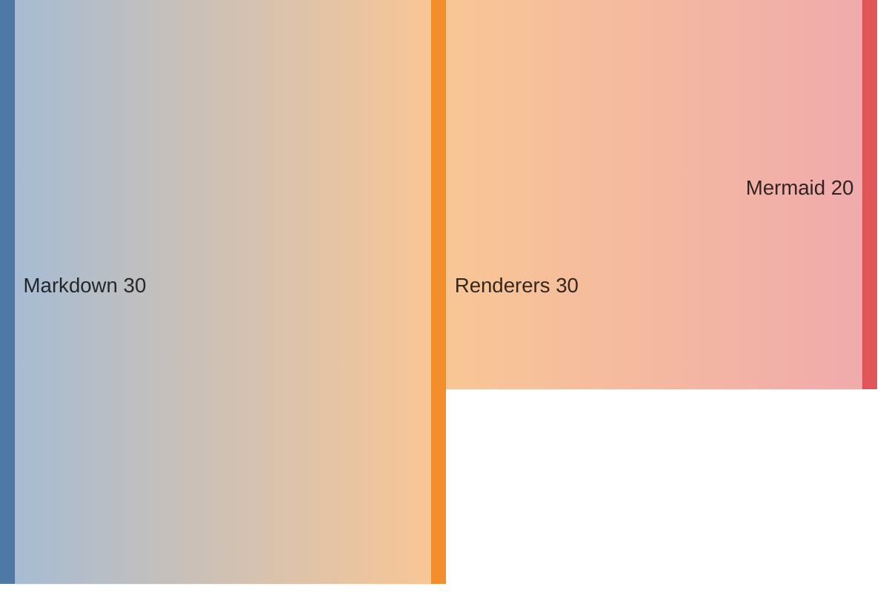
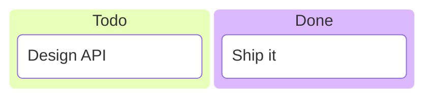

## Register the Mermaid renderer

Import the renderer package before rendering a Mermaid fence. It may be loaded from the application entry or lazily with the route.

```js
import "@bndynet/ichat";
import "@bndynet/ichat-renderer-mermaid"; // Auto-registers the Mermaid renderer
import { textPart } from "@bndynet/ichat";

const chat = document.querySelector("i-chat-messages");
```

## Switch themes

Use the picker above the diagrams, or call `setDefaultMermaidTheme()` from code. It changes the default for every diagram and re-renders the ones already on screen.

```js
import { setDefaultMermaidTheme } from "@bndynet/ichat-renderer-mermaid";

setDefaultMermaidTheme("forest"); // "auto" | "base" | "default" | "dark" | ...
```

## Send the page's diagrams

The demo page renders **16 diagram types**: Flowchart, Sequence, Graph, Class, State, ER, Gantt, Pie, Journey, Quadrant, Mindmap, Timeline, Git graph, XY chart, Sankey, and Kanban.

```js
const diagram = `## Class diagram

\`\`\`mermaid
classDiagram
  class ChatMessage {
    +String id
    +String role
  }
  class TextPart {
    +String text
  }
  ChatMessage "1" *-- "many" TextPart : contains
\`\`\`

## State diagram

\`\`\`mermaid
stateDiagram-v2
  [*] --> Idle
  Idle --> Streaming : send
  Streaming --> Idle : done
\`\`\`

## Pie

\`\`\`mermaid
pie title Renderer usage
  "Mermaid" : 45
  "Chart" : 30
\`\`\`
`;

chat.addMessage({
  id: crypto.randomUUID(),
  role: "assistant",
  timestamp: Date.now(),
  parts: [textPart(diagram)],
});
```

## More diagram fences












